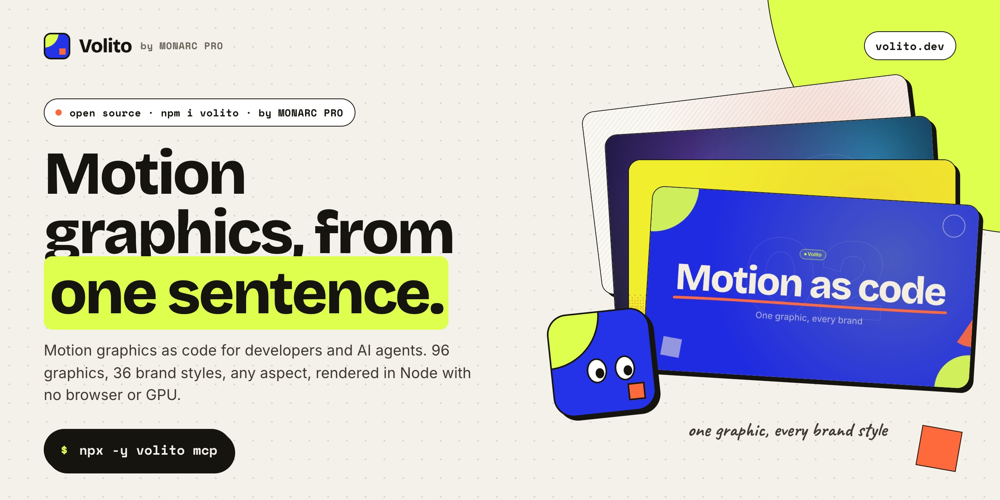
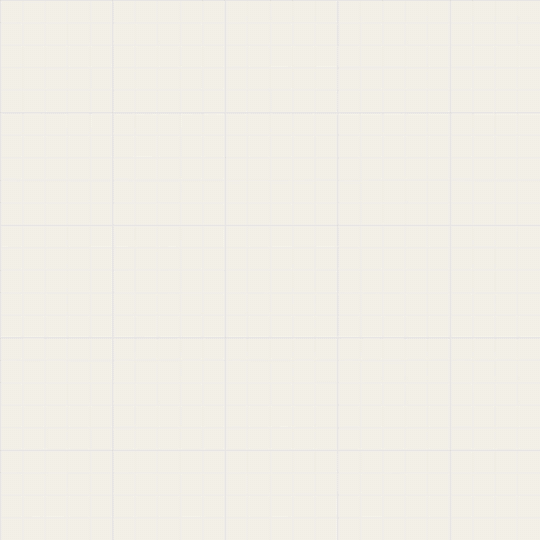
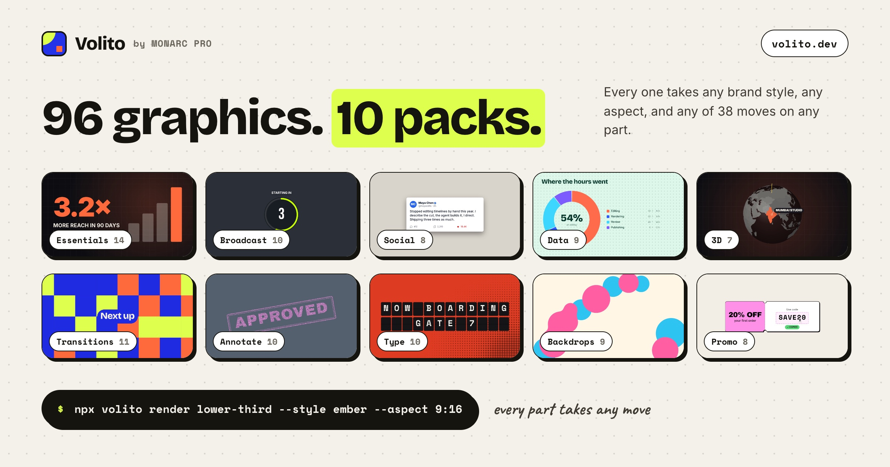
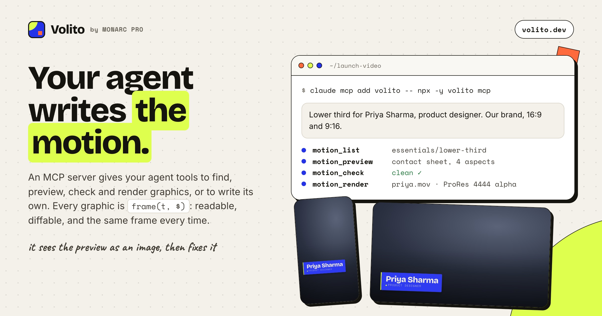

<p align="center">
  <a href="https://volito.dev"></a>
</p>

<h1 align="center">Volito</h1>

<p align="center"><strong>Brand-aware, voice-synced motion graphics as code — for developers and AI agents.</strong></p>

<p align="center">
  <a href="https://www.npmjs.com/package/volito"></a>
  <a href="https://github.com/monarcpro/volito/actions/workflows/ci.yml"></a>
  <a href="LICENSE"></a>
  <a href="https://volito.dev/docs"></a>
</p>

<p align="center">
  <a href="https://volito.dev">Website</a> ·
  <a href="https://volito.dev/docs">Docs</a> ·
  <a href="https://volito.dev/docs/packs">Packs</a> ·
  <a href="https://volito.dev/docs/agents">For agents</a> ·
  <a href="https://www.npmjs.com/package/volito">npm</a> ·
  <a href="CHANGELOG.md">Changelog</a>
</p>

By [MONARC STUDIOS](https://monarcpro.app), the team behind MONARC PRO. Volito is the motion graphics engine
inside the [MONARC PRO](https://monarcpro.app) video editor, opened up; the name is Latin for “to flutter”.
Every graphic is a small program — `function frame(t, $)` returns the SVG of one frame — so it is
readable, diffable, seekable to any frame, and something an AI agent can write and fix. It ships with
96 ready-made graphics in ten packs (3D, maps, transitions and kinetic type among them), 36 brand styles,
sixteen animated patterns, a CLI, a Node API, a browser player and an MCP server, and renders to ProRes 4444 or HEVC with alpha, WebM, MP4, GIF, PNG frames or SVG.

- **One design, every brand.** Items draw with colour roles and faces, not fixed colours: pass one of 36
  built-in styles, your `DESIGN.md`, or a couple of overrides, and the whole pack re-skins.
- **One design, every aspect.** Layouts follow the canvas and keep to title-safe areas, including the
  space platforms reserve on 9:16. 16:9, 9:16, 1:1 and 4:5 from the same item.
- **On the voice.** Give a transcript and text lands on the words that say it.
- **Drops onto footage.** Overlays render with real alpha for Premiere, Resolve, Final Cut, After
  Effects and CapCut.
- **Agent-native.** An MCP server gives Claude Code, Cursor and other agents tools to find, preview (as an
  image they can see), check and render graphics — or to write their own.
- **Many scripts.** Latin, Latin Extended, Vietnamese, Cyrillic, Greek and Devanagari (Hindi), shaped properly.

<p align="center">
  <br>
  <sub>This intro is a Volito program: kinetic type, a 3D wordmark and an end card, rendered in Node.</sub>
</p>

```bash
npx volito render lower-third \
  --prop name="Priya Sharma" --prop role="Product designer" \
  --style ember --aspect 16:9 --out priya.mov
```

## Install

```bash
npm install volito      # or run it with npx, nothing to install
```

Volito was first published as `@monarcpro/motion`; that package is deprecated in favour of this one.

Node 20.10 or newer. Video formats need [ffmpeg](https://ffmpeg.org) on your `PATH` (or `VOLITO_FFMPEG`);
stills, contact sheets and PNG frames do not. WebM needs an ffmpeg built with libvpx.

## The packs



96 graphics in ten packs. Every one takes any brand style and any aspect, and every part of it takes any move.

| Pack | Items |
| --- | --- |
| **Essentials** (14) | `lower-third` · `title-card` · `headline` (kinetic, on the voice) · `subscribe` · `social` · `callout` · `stat` · `bar-chart` · `steps` · `quote` · `banner` · `end-card` · `logo-sting` · `wipe` |
| **Broadcast** (10) | Lower thirds in five looks — `lt-bars`, `lt-reveal` (mask reveal), `lt-kicker`, `lt-pill` (picture or initials, status dot), `lt-news` (tight boxes) — `ticker` (crawl), `live-badge` (viewers, clock), `score-bug` (teams, scores, clock, goal flash), `location` (pin and place card), `countdown` |
| **Social** (8) | `follow-card` (profile, count, Follow press) · `notification` (phone or desktop) · `notifications` (a stack that cascades) · `comments` (typing on) · `chat` (thread with typing dots) · `post` (counts and a heart) · `now-playing` (music card) · `rating` (stars, score, review) |
| **Data** (9) | `line-chart` (draws on, target line) · `donut` · `bar-race` (overtaking across periods) · `goals` (meters) · `versus` · `timeline` · `funnel` · `world-map` (countries filled by value, regions) · `flight` (a great-circle route between two places) |
| **3D** (7) | `logo-3d` (extruded wordmark, light sweep) · `title-3d` (letters flip up) · `number-3d` (an extruded counter) · `card-flip` (front and back) · `cube` (a word prism that rolls) · `bars-3d` (orbiting camera) · `globe` (spins to a country, routes arc in) |
| **Transitions** (11) | Cover the frame by the cut, reveal the next shot: `iris` (circle, diamond, star, square) · `blinds` · `doors` (with a Bauhaus disc) · `glitch` · `ink` (wobbly blooms) · `clock` · `tiles` (Bauhaus shapes) · `pixels` · `stripes` · `slices` · `whip` — each with a word at the cut |
| **Annotate** (10) | Point at things in footage (places in % of the frame): `arrow` (hand-drawn or clean) · `circle` · `spotlight` (feathered dim) · `focus` (brackets that lock on) · `highlight` (highlighter, underline, box, strike) · `stamp` (pressed ink) · `reactions` (live hearts, likes, fire) · `pointer` (leader line and card) · `emphasis` · `markers` (numbered) |
| **Type** (10) | Kinetic type: `typewriter` · `word-swap` (a word that keeps changing) · `split-flap` · `marquee` (tilted scrolling bands) · `echo` · `liquid-fill` · `decode` · `word-by-word` · `key-phrase` (marker on *marked* words) · `stack` (editorial) |
| **Backdrops** (9) | Moving grounds: `pattern` (any of the sixteen) · `aurora` · `tiles` (Bauhaus field) · `retro-grid` (synthwave) · `blobs` (lava goo) · `gradient` · `starfield` · `bokeh` · `topo` |
| **Promo** (8) | `sale-badge` (starburst) · `price-card` (counts down, strike, click) · `coupon` (copy the code) · `offer-countdown` (D:H:M:S) · `features` (checklist) · `cta` (button and cursor) · `launch` · `ribbon` (crossing tapes) |

`volito info <item>` lists every prop. To see them all live, serve this package's folder and
open `examples/gallery.html`.

## Motion without limits

Every item is made of named **parts** (`volito info lower-third` lists them: `scrim`, `spine`, `plate`,
`name`, `role`). Any part takes any move, and the moves combine freely:

```bash
volito render lower-third \
  --motion name.in=typewriter --motion plate.in=iris --motion "*.ease=bouncy" \
  --motion role.emphasis=pulse@2 --motion spine.idle=pulse --out priya.mov
```

| Setting | Takes |
| --- | --- |
| `in`, `out` | 38 moves — `rise` `drop` `slide` `smear` `arc` `pop` `zoom` `push` `grow` `wipe` `iris` `shutter` `blinds` `diagonal` `blur` `flip` `turn` `spin` `roll` `swing` `skew` `stretch` `squash` `bounce` `elastic` `slam` `tilt` `float` `glitch` `flicker` `typewriter` `scramble` … An exit plays its move backwards. |
| `ease` | `out` `inOut` `expo` `back` `elastic` `bounce`, springs `snappy` `punchy` `bouncy` `calm` `wobbly`, or `spring(f,d)`, `steps(n)`, `cubic(x1,y1,x2,y2)` |
| `from`, `outFrom` | the side a move comes from or leaves to (`left`, `right`, `up`, `down`, diagonals) |
| `dur`, `delay`, `at`, `outAt`, `distance`, `intensity`, `origin`, `blur` | timing, travel, scale, pivot, motion blur |
| `idle` | a loop while it holds: `float` `bob` `pulse` `breathe` `wiggle` `sway` `drift` `jitter` `spin` `heartbeat` `shimmer` |
| `emphasis` | hits at a time, a beat or a spoken word: `"shake@1.2, pop@now"` (`pulse` `pop` `shake` `jump` `wobble` `flash` `spin` `rubber` `tada`) |
| `split`, `order`, `stagger` | text whole, or by `lines` / `words` / `letters`, `forward` `reverse` `center` `edges` `random` |
| `keys` | your own keyframes: `[{"t":0,"x":-300,"op":0},{"t":0.8,"x":0,"op":1,"ease":"bouncy"}]` — any path |

Or let it choreograph itself: `--mood energetic | elegant | playful | cinematic | glitchy | minimal | retro | kinetic`,
and `--seed <n>` for a new take on every number (the same number always moves the same way). `--speed 2` plays
it all twice as fast. `volito moves` lists everything. Programs you write get the same kit:
`const M = motion($, t); M.part("card", { at, in: "pop", box }, markup)`.

## 3D and maps

The 3D items are real geometry, not tricks: meshes are lit, faces turned away are culled, everything is
sorted far to near and projected through a perspective camera — then drawn as SVG paths, so 3D renders on
any machine with no GPU, at the same speed as the rest. 3D text is extruded from the outlines of the
bundled faces (read straight from the font files), so a logo turns in the brand's own type.

```js
function frame(t, $) {
  const S = scene3d($, { camera: { yaw: -20 + 40 * (t / $.dur), pitch: -8 } });
  S.add(S.text("VOLITO", { face: $.font("display"), size: 220 * $.k, depth: 60 * $.k, color: $.c.fg, side: $.c.accent }));
  return S.render();
}
```

Maps use Natural Earth's countries (177, packed into 30 KB): `worldMap($, { center, zoom })` projects them
flat (Equal Earth), `worldGlobe(S, …)` puts them on a 3D globe, and `worldFind("UK")` finds one by name,
short name or ISO number. `volito api` documents both.

## CLI

```bash
volito list                                   # every item
volito info stat                              # what it is, every prop
volito styles                                 # the built-in brand styles
volito moves                                  # every move, ease, idle, hit and mood
volito sheet title-card --mood playful --seed 7   # a new choreography
volito sheet stat --prop value=72 --prop suffix=% --prop chart=ring   # frames across time, one PNG
volito still title-card --aspect 9:16 --t 1.5 --out frame.png
volito render banner --prop headline="Doors open at 9" --format webm --out banner.webm
volito check ./my-graphic.js                  # run it at every aspect, report problems
```

| Option | |
| --- | --- |
| `--prop name=value` | a prop (repeat). Lists: `"a; b; c"`. Chart rows: `"Label: 42; Other: 17"` |
| `--props <json or file>` | every prop at once |
| `--image name=path` | a picture for an image prop (a file or URL) |
| `--style <name or DESIGN.md>` | a built-in style or your brand's `DESIGN.md` |
| `--accent --accent2 --ink --paper #hex` · `--mode dark\|light` · `--display --text Font:900` | overrides on the style |
| `--aspect 16:9\|9:16\|1:1\|4:5\|WxH` · `--duration s` · `--fps n` · `--width px` | the frame |
| `--bg #hex\|transparent` | a ground under the graphic |
| `--words transcript.json` · `--offset s` | land text on a voice (`[{w, s, e}]` or Whisper JSON) |
| `--motion part.setting=value` | how a part moves (repeat; `*` for every part) — see *Motion without limits* |
| `--mood m` · `--seed n` · `--speed x` | a choreography, a new take per seed, faster or slower |
| `--beat in=0.4 --beat out=-0.6` | move the entrance and exit (negative counts from the end) |
| `--packs <dir>` | more packs (also `VOLITO_PACKS`) |
| `--format mov\|webm\|mp4\|hevc\|gif\|png` | for `render`; `png`/`svg` for `still` |

| Format | |
| --- | --- |
| `mov` | ProRes 4444 with alpha — the default; for every desktop editor |
| `hevc` | HEVC with alpha in .mov — small files for Final Cut, iMovie, Safari (macOS) |
| `webm` | VP9 with alpha — for the web and CapCut |
| `mp4` | H.264, no alpha — drawn on `--bg` (black) |
| `gif` | animated GIF, 1-bit transparency |
| `png` | a folder of PNG frames with alpha |

## AI agents (MCP)



```bash
claude mcp add volito -- npx -y volito mcp
```

Cursor, Windsurf and other MCP clients:

```json
{ "mcpServers": { "volito": { "command": "npx", "args": ["-y", "volito", "mcp"] } } }
```

| Tool | |
| --- | --- |
| `motion_list` | find graphics by words or category |
| `motion_info` | an item's props (and its source with `code: true`) |
| `motion_styles` | the brand styles |
| `motion_preview` | a contact sheet as an image — the agent sees how it moves and whether text fits |
| `motion_still` | one frame as an image |
| `motion_check` | errors and warnings at every aspect |
| `motion_render` | render to a file and return its path |
| `motion_moves` | every move, ease, idle, hit and mood the `motion` settings take |
| `motion_api` | the program API and the motion kit, for writing new graphics |

Every tool takes an `item` or your own `code`, plus `motion`, `mood`, `seed` and `speed`. A ready-made agent skill is in `skill/SKILL.md` — copy it
to `~/.claude/skills/volito/` for Claude Code.

## Node API

```js
import { findItem, renderVideo, renderStill, renderSheet, checkItem } from "volito";

const item = findItem("essentials/lower-third");
const result = await renderVideo(item, {
  props: { name: "Priya Sharma", role: "Product designer" },
  style: "ember",                 // or the text of a DESIGN.md, or { colors, fonts, … }
  colors: { accent: "#00A86B" },  // overrides
  aspect: "9:16",
  out: "priya.mov",
});
console.log(result.file, result.frames, result.warnings);
```

## Browser

```js
import { loadRegistry, findItem, createPlayer } from "volito/browser";

const registry = await loadRegistry();       // the packs, from jsDelivr (or pass your own base URL)
const player = await createPlayer(canvas, findItem(registry, "headline"), {
  props: { text: "Stop editing. *Start directing.*" },
  style: "neon",
  aspect: "16:9",
});
player.play();   // also: pause(), seek(t), update({ props }), destroy()
```

The player runs each program in a sandboxed Web Worker and draws through the same SVG path as the
renderer, so what plays on the page is what renders. Fonts load from `base` (the package's own
`fonts/` on jsDelivr by default); serve the package's `fonts/` and `dist/registry.json` to stay offline.

## Brand styles

36 built in. MONARC PRO's: `ember`, `cream`, `mono`, `neon`, `pop`, `studio`, and the explainer art
styles `whiteboard`, `sketch`, `pastel`, `pixel`, `collage`, `diorama`, `clay`, `storybook`. And Volito's
own, each with an animated pattern for a ground:

| Style | Look | Pattern |
| --- | --- | --- |
| `cobalt` | cobalt colour field, cream type, acid lime | `bauhaus` |
| `tomato` | tomato-red poster, black slabs | `halftone` |
| `acid` | acid-yellow sheet, indigo serif | `dither` |
| `candy` | neo-brutal: outlines, hard shadows, pink and yellow | `dots` |
| `riso` | risograph pink and blue on paper | `halftone` |
| `aurora` | night with drifting violet and cyan light, glass | `mesh` |
| `sunset` | plum ground, coral and gold blooms | `mesh` |
| `lime` | ink ground, electric lime | `plus` |
| `sport` | black, volt and blaze, condensed caps | `stripes` |
| `retro` | seventies cream, orange and mustard, fat serif | `waves` |
| `diner` | cream, cherry and teal, script headline | `checker` |
| `blueprint` | graph paper, cobalt ink, serif | `graph` |
| `forest` | deep green field, peony pink, soft serif | `rings` |
| `luxe` | black and champagne gold, deco | `sunburst` |
| `capsule` | outlined pills, coral and lime | `pills` |
| `memphis` | warm white, hot pink and sky, confetti | `confetti` |
| `swiss` | off-white, black, signal red, heavy Inter | `tiles` |
| `terminal` | phosphor green monospace | `dither` |
| `vapor` | synthwave magenta and cyan | `waves` |
| `scifi` | HUD cyan, geometric display | `plus` |
| `mint` | mint sheet, coral pop | `dots` |
| `editorial` | magazine black and red, didone | `hatch` |

`volito styles` lists them all. Or pass a `DESIGN.md`:

```markdown
---
name: acme
mode: light
colors:
  accent: "#00A86B"
  accent2: "#FFD23F"
  ink: "#101418"
  paper: "#FAFAF7"
fonts:
  display: "Poppins:800"
  text: "Inter:600"
motion: bouncy
surface: glass
---
# Acme
Friendly, confident, never shouty.
```

Faces available: Inter, Space Grotesk, Space Mono, Poppins, Playfair Display, Montserrat, Anton, Outfit,
Gabarito, Caveat, Press Start 2P, Permanent Marker, Patrick Hand, Fredoka, IM Fell English, Bebas Neue,
DM Serif Display, Archivo Black, Syne, Unbounded, Righteous, Orbitron, Pacifico, Fraunces and Bricolage Grotesque.

### Patterns

A style's `texture` can name any of sixteen animated patterns, and every ground the items draw picks it
up: `dots`, `plus`, `graph`, `hatch`, `stripes`, `checker`, `halftone`, `dither`, `waves`, `rings`, `mesh`,
`confetti`, `bauhaus`, `tiles`, `pills`, `sunburst` (the editor's `grid`, `glow`, `grain`, `paper`, `board`,
`parchment`, `pixel` and `studio` still work). Programs can draw one anywhere:

```js
s += $.pattern(t, "halftone", { box: { x: 0, y: 0, w: W, h: H }, a: 1.2, scale: 1, speed: 0.5 });
```

Options: `box`, `color`, `color2`, `a` (strength), `scale`, `speed`, `angle`, `at` ([x, y] for rings,
halftone, sunburst), `count`, `seed`, `r`. They are pure functions of time like everything else — no GPU.

## Write your own

```bash
volito new promo-card        # item.json + frame.js from a template
volito sheet ./motion/promo-card
volito api                   # the whole $ runtime
volito guide                 # how items and packs are laid out
```

```js
function frame(t, $) {
  const p = $.data, k = $.k;                       // props, and the canvas scale (1 at 1080 px)
  const tin = $.beat("in", 0.2);
  return $.g($.enter(t, tin, { dy: 60 * k, ox: $.W / 2, oy: $.H / 2 }),
    $.card($.W / 2 - 320 * k, $.H / 2 - 110 * k, 640 * k, 220 * k),
    $.text($.case(p.title ?? "Hello"), { ...$.font("display"), size: 80 * k, x: $.W / 2, y: $.H / 2 - 44 * k, anchor: "middle" }));
}
```

A program is a pure function of `t`: no `Date`, `Math.random` (use `$.hash`), timers, network or DOM.
Size by `$.k`, colour from `$.c`, faces from `$.font(role)`, and a brand's `DESIGN.md` re-skins it.
A pack is a folder with `pack.json`, a `shared.js` of helpers and one folder per item; load it with
`--packs <dir>`.

## How it renders

Node runs each program in a fresh `vm` context holding the same worker source MONARC PRO uses.
Only strings and numbers cross into it, and eval, `Function`, `require`, `process` and the network are
out of reach. Text is measured with fontkit against the bundled faces; frames are rasterised by
[resvg](https://github.com/RazrFalcon/resvg); text beyond a face's Latin cut is shaped by fontkit and
drawn as outlines, and dash patterns written against `pathLength` (which resvg ignores) are scaled to
each shape's real length first. Frames that don't change are drawn once. The motion kit, the 3D kit and
the map data ship as libraries that are added to a program when it is built: items stay small, and the
60 000-character limit applies only to what an item's author (or an agent) wrote.

`vm` keeps mistakes contained, but it is not a security boundary. Run packs you trust, as you would
any npm package.

## Development

```bash
pnpm install          # Node 22.18 or newer for development (the package itself runs on Node 20.10+)
pnpm build            # fonts/ from Fontsource, then dist/
pnpm test
node dist/cli.js sheet lower-third --mood playful --seed 7 --out sheet.png
```

`node scripts/review.mjs <aspect> <style> [items | pack:<id>] [times]` writes contact sheets to `out/`,
`node scripts/styles.mjs [styles] [items]` one row per style, `node scripts/strip.mjs <items> <aspect> <style>
<times> '<props JSON>'` the same props across several items,
`node scripts/variants.mjs <item>` one item under many seeds, and `node scripts/demo-grid.mjs <item>` a 3×3
video of nine choreographies.

The engine in `src/engine/` (the runtime every program draws with, its sandbox and the brand styles) is the
same code MONARC PRO uses, copied from MONARC PRO's core so this repo stands alone; `src/engine/SOURCE.json`
names the commit. With a MONARC PRO checkout (`../monarc`) next to this one, `pnpm sync-engine` brings it up to date and
`node scripts/sync-engine.mjs --check` reports drift. Packs, the motion kit (`src/kit.ts`), the extra
faces (`src/fonts-extra.ts`), styles (`src/styles-extra.ts`) and patterns (`src/patterns.ts`) live here;
`src/engine.ts` splices the faces and patterns into the runtime without editing the copy.

## Licence

- The engine: [MIT](LICENSE).
- The MONARC packs: the [MONARC Packs License](PACKS-LICENSE.md). Use them in any video, personal or
  commercial, with no attribution required. Don't resell them as templates.
- The fonts: each family's SIL Open Font License, in `fonts/licenses/` of the installed package
  (`pnpm build` writes that folder in a checkout).

## Contributing

Issues and pull requests are welcome: [CONTRIBUTING.md](CONTRIBUTING.md) covers the setup, the tests and
how items and packs are written. Report security problems privately, as [SECURITY.md](SECURITY.md) says.

Made by [MONARC STUDIOS](https://monarcpro.app), the team behind [MONARC PRO](https://monarcpro.app).
